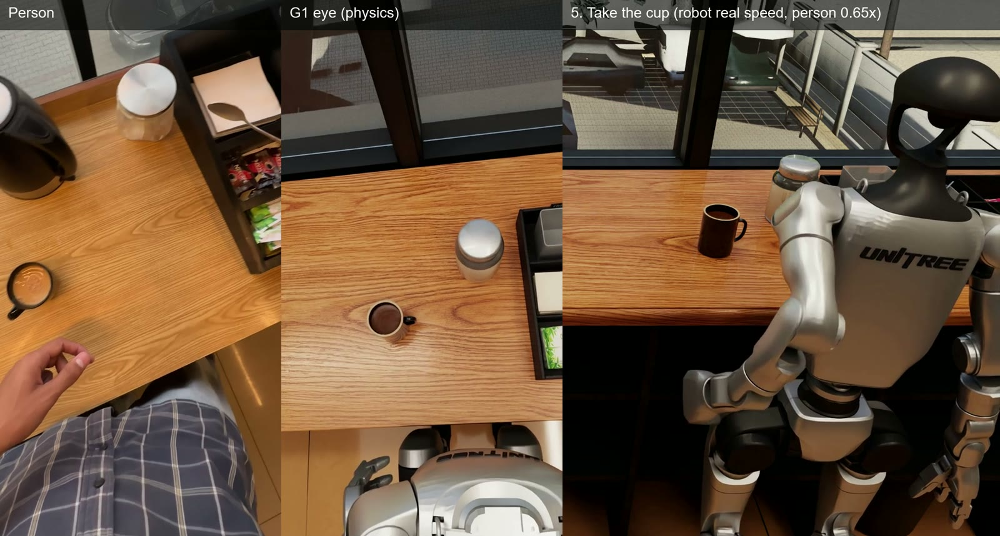
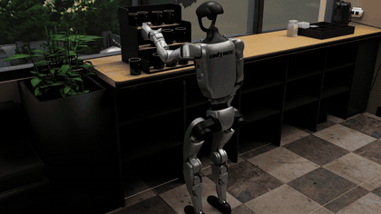
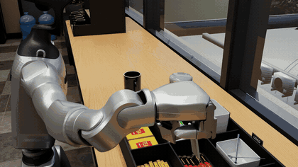
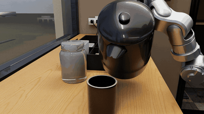
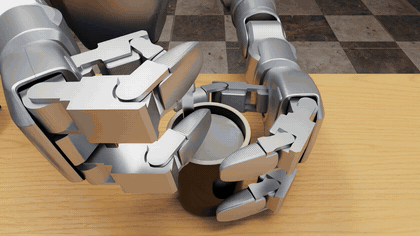
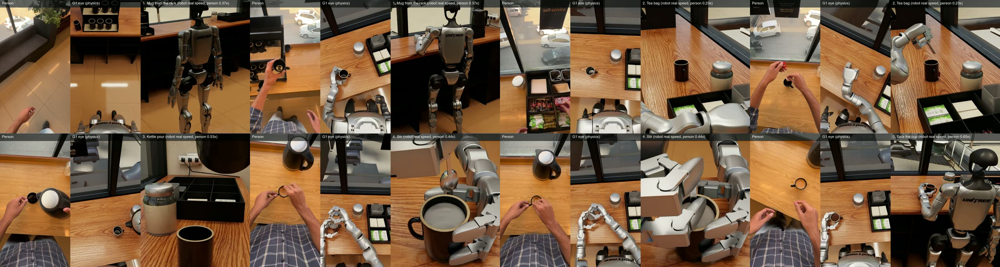

<div align="center">

# Robot Episodes

### Simulated robot manipulation in a digital twin of a real kitchen

Two robots. Two household tasks. Videos, recordings, datasets and code.

<!-- STRETCH_FILL: Stretch hero image, assets/stretch_hero.jpg, linked to its Drive video -->

<a href="DRIVE_LINK_2_G1_tea_full_film.mp4"></a>

**[Stretch pizza](#stretch-pizza)** · **[G1 tea](#g1-tea)** · **[All videos](videos/README.md)** · **[Load the data](#load-the-data)**

</div>

---

## Stretch pizza

A Stretch 3 takes a plate with a pizza, carries it past the oven and sets it down, opens the oven door, places the plate on the rack and closes the door. It turns three knobs, waits, opens the door, takes the plate out and carries it back.

| | |
|---|---|
| Robot | Hello Robot Stretch 3 |
| Simulator | Isaac Sim, CPU PhysX |
| Operation | AI-operated |
| Episode | One continuous take, about 20 minutes of sim time |
| Recording | 30 samples per sim second |
| Camera views | Head, wrist and fixed |

<!-- STRETCH_FILL: Stretch GIF previews from the pz_final03 views, each linked to its Drive video -->

[All Stretch videos](videos/stretch_pizza/README.md)

---

## G1 tea

A Unitree G1 with three-finger hands makes tea, following a person's head-camera video. Each step is its own physics run in MuJoCo, rendered in Isaac Sim.

<table>
<tr>
<td align="center"><a href="DRIVE_LINK_1_mug_film.mp4"></a><br><b>Mug from the rack</b></td>
<td align="center"><a href="DRIVE_LINK_2_teabag_film.mp4"></a><br><b>Tea bag into the mug</b></td>
<td align="center"><a href="DRIVE_LINK_3_pour_film.mp4"></a><br><b>Kettle pour</b></td>
</tr>
<tr>
<td align="center"><a href="DRIVE_LINK_5_stir_closeup.mp4"></a><br><b>Stir</b></td>
<td align="center"><a href="DRIVE_LINK_6_cup_film.mp4"></a><br><b>Take the cup and walk away</b></td>
<td align="center"><a href="DRIVE_LINK_2_G1_tea_full_film.mp4"></a><br><b>Full film</b></td>
</tr>
</table>

| | |
|---|---|
| Robot | Unitree G1 with three-finger hands, 43 joints |
| Simulator | MuJoCo, 600 Hz, torque-limited motors |
| Rendering | Isaac Sim |
| Operation | AI-operated |
| Recording | 60 frames per second |
| Water | PhysX fluid in the pour |

[All G1 videos](videos/g1_tea/README.md)

---

## Data

### Stretch: `stretch_pizza/data/`

NumPy `.npz`, one sample every 1/30 of a sim second.

| Key | Shape | Meaning |
|---|---|---|
| `t` | N | Sim time, seconds |
| `names` | 20 | Joint names |
| `links` | 37 | Link names |
| `q`, `dq` | N x 20 | Joint positions and velocities |
| `qd`, `vd` | N x 20 | Commanded position and velocity targets |
| `root` | N x 7 | Base pose: x y z, quaternion x y z w |
| `link` | N x 37 x 7 | Pose of every link |
| `oven` | N x 5 | Oven joints, door first, radians |
| `plate`, `pizza` | N x 7 | Object poses |

<!-- STRETCH_FILL: add the extra pz_final03 keys (oven body pose, heat state) and the view-frame index -->

`stretch_pizza/lerobot/` holds the same take as a LeRobot v3.0 dataset with camera video.

### G1: `g1_tea/data/`

`per_step/` has one folder per step, with `motion.npz`, CSV copies, `metadata.json` and the robot model.

| Key in `motion.npz` | Shape | Meaning |
|---|---|---|
| `t` | N | Time, seconds |
| `joint_names`, `motor_names` | 43 | Joint and motor names |
| `joint_pos`, `joint_vel` | N x 43 | Joint positions and velocities |
| `motor_torque` | N x 43 | Torque magnitude per motor, N m |
| `motor_limit` | 43 | Motor torque limits, N m |
| `base_pos_quat` | N x 7 | Pelvis pose: x y z, quaternion w x y z |
| `object_names`, `object_pos_quat` | N x M x 7 | Object poses |
| `eye_cam_pos_rotmat` | N x 12 | Head camera position and rotation |

`lerobot/` holds the five steps as a LeRobot v3.0 dataset, one episode per step. See its [README](g1_tea/data/lerobot/README.md).

`g1_tea/recordings/` holds the full MuJoCo state of each run at 60 frames per second.

---

## Load the data

```bash
python examples/load_stretch.py stretch_pizza/data/pz_final03_rec.npz
python examples/load_g1.py g1_tea/data/per_step/step3_pour
python examples/load_lerobot.py g1_tea/data/lerobot
```

```python
import numpy as np

d = dict(np.load("stretch_pizza/data/pz_final03_rec.npz"))
print(d["t"].shape, d["q"].shape, d["plate"][-1])
```

## Replay G1 in MuJoCo

```bash
cd g1_tea
pip install -r requirements.txt
python work/replay.py recordings/3_pour_pour35.npz
python work/replay.py recordings/3_pour_pour35.npz --video pour.mp4 --cam eye
```

---

## Repository layout

```
videos/                   video index, previews and Drive links
  g1_tea/                 every G1 video
  stretch_pizza/          every Stretch video
  previews/               small GIF previews
stretch_pizza/
  data/                   full recording
  lerobot/                LeRobot v3.0 dataset
  code/                   task, oven, kitchen, recorder, replay and export code
g1_tea/
  data/per_step/          motion data for each step
  data/lerobot/           LeRobot v3.0 dataset
  recordings/             full MuJoCo state of each run
  work/                   scene builder, step skills, replay, export and render scripts
  handoff/                robot model, controller and kitchen twin
examples/                 data loaders
assets/                   images for this page
```
