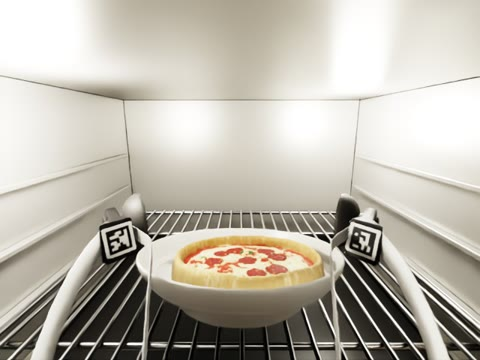
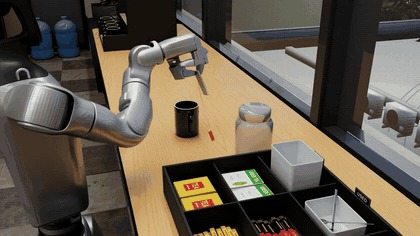
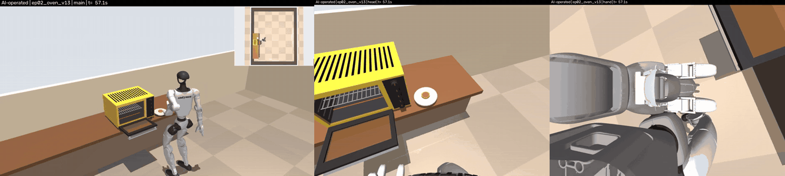
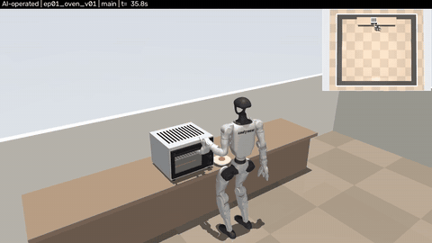
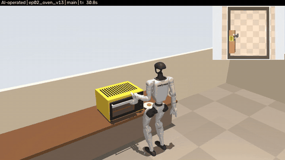
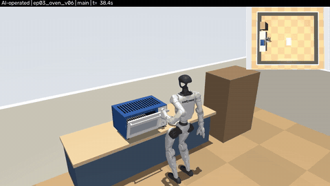
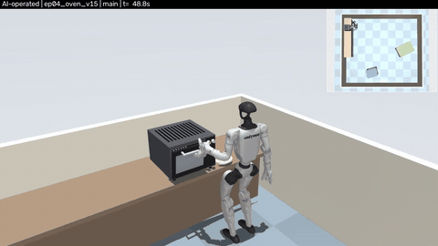
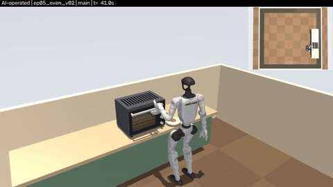

# Robot Episodes

### Simulated robot manipulation in a digital twin of a real kitchen

Three robots. Household tasks. Videos, recordings, datasets and code.

---

<table>
<tr>
<td align="center" width="33%"><a href="stretch/README.md"> <b>Stretch</b></a> Pizza in and out of an oven Isaac Sim, CPU PhysX</td>
<td align="center" width="33%"><a href="g1/README.md"> <b>G1</b></a> Making tea, and the <a href="g1/oven/README.md">full oven task</a> in 5 rooms MuJoCo, rendered in Isaac Sim</td>
<td align="center" width="33%"><a href="h1_2/README.md"> <b>H1-2</b></a> Making tea with live water Isaac Sim, GPU PhysX</td>
</tr>
</table>

All runs are simulation and AI-operated.

## New: G1 full oven task, 5 rooms, 5 different ovens

A Unitree G1 walks to the counter, opens the oven, puts the plate on the rack, closes the door, turns the knob, heats the food, opens the door, takes the plate out, puts it back on the counter and closes the door. Each episode is about 8 minutes of whole-body torque-controlled physics in a different room with a different oven, objects moved by contact only, and every episode passes all 20 validator checks. Main, head-camera and hand-camera views.

<table>
<tr>
<td align="center"> Oven v01</td>
<td align="center"> Oven v13</td>
<td align="center"> Oven v06</td>
<td align="center"> Oven v15</td>
<td align="center"> Oven v02</td>
</tr>
</table>

[Episodes, recordings, validator results and full videos](g1/oven/README.md)

| Robot | Folder | Videos | Data |
|---|---|---|---|
| Stretch 3 | [stretch/](stretch/README.md) | [Videos](stretch/videos/README.md) | Full recording and LeRobot dataset; [30 generated rooms](stretch/rooms/README.md), 30 recorded episodes |
| Unitree G1 | [g1/](g1/README.md) | [Videos](g1/videos/README.md) | Per-step motion data, MuJoCo recordings and LeRobot dataset; [G1 oven](g1/oven/README.md): 5 full 8-minute episodes in 5 rooms with main, head and hand videos |
| Unitree H1-2 | [h1_2/](h1_2/README.md) | [Videos](h1_2/videos/README.md) | [Saved runs](h1_2/data/README.md), recordings and water particles |

Each robot folder holds its own code, data, model, videos index and examples.
