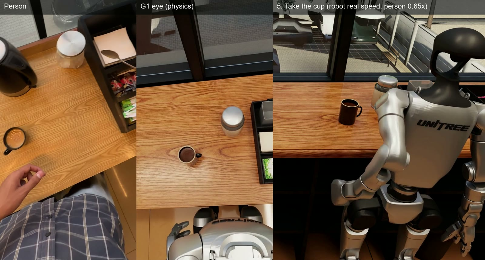
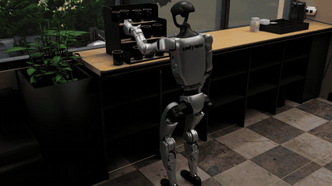
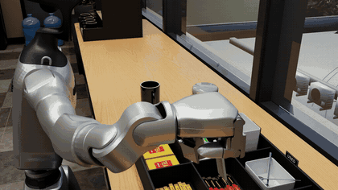
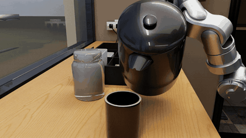
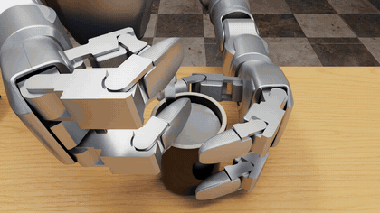
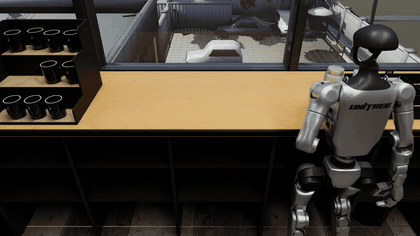
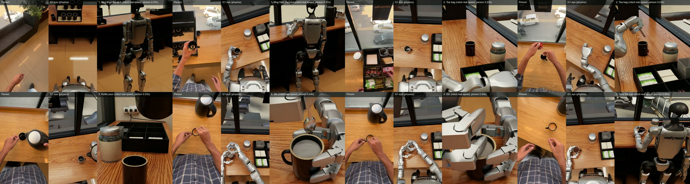

<div align="center">

# G1 tea

A Unitree G1 makes tea in a digital twin of a real kitchen

<a href="https://drive.google.com/file/d/1spM1i6wIExMvC1jkMVOc9FQAzvbNt_F0/view"></a>

</div>

A Unitree G1 with three-finger hands makes tea, following a person's head-camera video. Each step is its own physics run in MuJoCo, rendered in Isaac Sim.

<table>
<tr>
<td align="center"><a href="https://drive.google.com/file/d/1EK6eBAKdnizzRsaeaNjBeeCeCXAq2UNg/view"></a><br><b>Mug from the rack</b></td>
<td align="center"><a href="https://drive.google.com/file/d/1fDY5jhz7nwqIqgRuiV02NdJ5YdjpjeJY/view"></a><br><b>Tea bag into the mug</b></td>
<td align="center"><a href="https://drive.google.com/file/d/1HeH4_iTY3QBOXg1_lQlmVBzw7K9BOG24/view"></a><br><b>Kettle pour</b></td>
</tr>
<tr>
<td align="center"><a href="https://drive.google.com/file/d/1kpsRvo1WS-OJn2qgDVDvs2LpM2GksjER/view"></a><br><b>Stir</b></td>
<td align="center"><a href="https://drive.google.com/file/d/1UvGd_2ws0di6PxO1iZwcGZAzw8Hu1ksg/view"></a><br><b>Take the cup and walk away</b></td>
<td align="center"><a href="https://drive.google.com/file/d/1spM1i6wIExMvC1jkMVOc9FQAzvbNt_F0/view"></a><br><b>Full film</b></td>
</tr>
</table>

| | |
|---|---|
| Robot | Unitree G1 with three-finger hands, 43 joints |
| Simulator | MuJoCo, 600 Hz, torque-limited motors |
| Rendering | Isaac Sim |
| Operation | AI-operated |
| Recording | 60 frames per second |
| Water | PhysX fluid in the pour |

[All G1 videos](videos/README.md)

---

## Data

### `data/`

`per_step/` has one folder per step, with `motion.npz`, CSV copies, `metadata.json` and the robot model.

| Key in `motion.npz` | Shape | Meaning |
|---|---|---|
| `t` | N | Time, seconds |
| `joint_names`, `motor_names` | 43 | Joint and motor names |
| `joint_pos`, `joint_vel` | N x 43 | Joint positions and velocities |
| `motor_torque` | N x 43 | Torque magnitude per motor, N m |
| `motor_limit` | 43 | Motor torque limits, N m |
| `base_pos_quat` | N x 7 | Pelvis pose: x y z, quaternion w x y z |
| `object_names`, `object_pos_quat` | N x M x 7 | Object poses |
| `eye_cam_pos_rotmat` | N x 12 | Head camera position and rotation |

`lerobot/` holds the five steps as a LeRobot v3.0 dataset, one episode per step. See its [README](data/lerobot/README.md).

`recordings/` holds the full MuJoCo state of each run at 60 frames per second.

---

## Load the data

Run these from this folder.

```bash
python examples/load_g1.py data/per_step/step3_pour
python examples/load_lerobot.py data/lerobot
```

## Replay in MuJoCo

```bash
pip install -r requirements.txt
python work/replay.py recordings/3_pour_pour35.npz
python work/replay.py recordings/3_pour_pour35.npz --video pour.mp4 --cam eye
```

---

## Layout

```
videos/          video index and previews
data/per_step/   motion data for each step
data/lerobot/    LeRobot v3.0 dataset
recordings/      full MuJoCo state of each run
work/            scene builder, step skills, replay, export and render scripts
handoff/         robot model, controller and kitchen twin
examples/        data loaders
```
