<div align="center">

# G1 oven: five full episodes

A Unitree G1 walks to a counter, opens an oven, puts a plate of food inside, heats it and takes it out again. Five episodes, each in a different room with a different oven. MuJoCo physics, AI-operated.

<a href="https://drive.google.com/file/d/1giA4MM6OwIxPqlcoE12mJhu-exm-LBLy/view">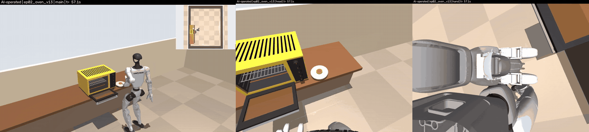</a>

Main view, head camera and left-hand camera at the same moment (ep02). Click for the full 7:51 video on Google Drive.

</div>

## What this data is

Each episode is one continuous, long-horizon humanoid task of 7.5 to 9 minutes of simulated time. In one run the robot walks about 20 m, opens a door, picks up and places a plate, turns a knob, waits for heating, takes the plate out and closes the door again. It uses the whole body: legs, torso, both arms and the three-finger hands.

- Torque-level physics: the 43-joint G1 is driven by a whole-body torque QP controller with motor torque limits. No welds, no teleports, no scripted object motion.
- Contact-only grasps: the plate is held by finger friction and the door is moved by a hand on its bar. The door has no latch, so the robot also holds it shut.
- Every episode is a different scene: room size and colours, counter placement, oven model (size, door, knob layout), plate size and mass all change.
- A validator of 20 checks with measured values (door angles, plate placement error and tilt, knob angle, food heated, oven drift, no fall, no wall or furniture contact) is stored in each `result.json`. All five episodes pass 20 of 20.
- Full state recordings (robot, plate, food, door, knobs, oven pose) and the exact scene description are included, ready for replay, re-rendering from any camera, imitation learning, evaluation and planning research.

## The five episodes

<table>
<tr><td><b>ep01_oven_v01</b><br>oven v01<br>room 5.6 x 5.0 m<br>7:29</td><td align="center"><a href="https://drive.google.com/file/d/1b-FuRY1DEDgqhK9FYFteDDjqZCG2atmF/view">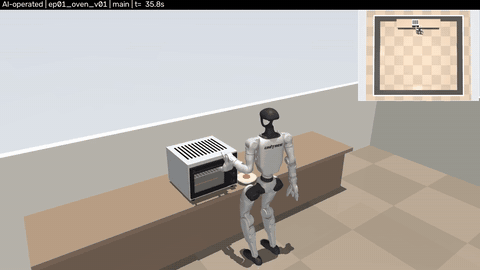</a><br>main view</td><td align="center"><a href="https://drive.google.com/file/d/1lGMOt_gMoCrD5JfYHwt31m-3fk2zvC6r/view">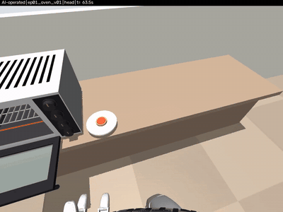</a><br>head view</td><td align="center"><a href="https://drive.google.com/file/d/1GYz-fbLOHWokBU_5nzx4kJMYn58wnn-V/view">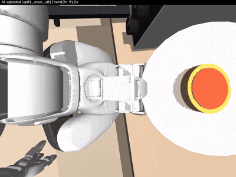</a><br>hand view</td></tr>
<tr><td><b>ep02_oven_v13</b><br>oven v13<br>room 4.26 x 5.35 m<br>7:51</td><td align="center"><a href="https://drive.google.com/file/d/1giA4MM6OwIxPqlcoE12mJhu-exm-LBLy/view">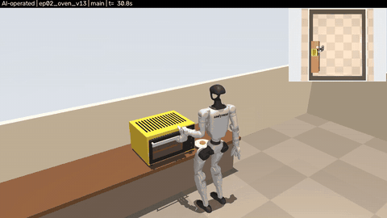</a><br>main view</td><td align="center"><a href="https://drive.google.com/file/d/1biX2H2bv4C1_oe4UzZ06n7DEf05IT85V/view">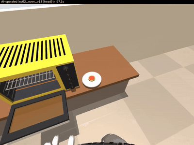</a><br>head view</td><td align="center"><a href="https://drive.google.com/file/d/1ax3EBs_EoB0cvAJ87ROG2NBk7kBTR5rp/view">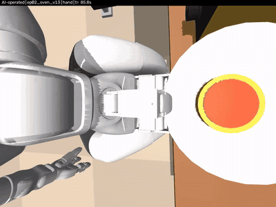</a><br>hand view</td></tr>
<tr><td><b>ep03_oven_v06</b><br>oven v06<br>room 5.45 x 4.65 m<br>8:33</td><td align="center"><a href="https://drive.google.com/file/d/1Y1A11CWfmuH25OKav76GqcmtEpAiP7ef/view">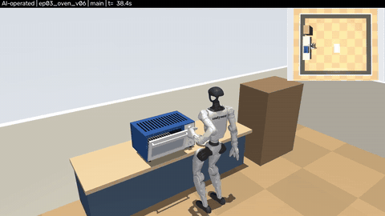</a><br>main view</td><td align="center"><a href="https://drive.google.com/file/d/1AHWR0iHzwGjfoClS7cum8ZiYz7JVd4ig/view">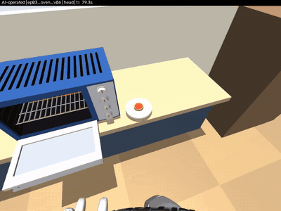</a><br>head view</td><td align="center"><a href="https://drive.google.com/file/d/1dUpJoU6N2EhYZy4WJCeBYQ2FgqCBMNcU/view">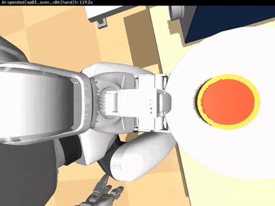</a><br>hand view</td></tr>
<tr><td><b>ep04_oven_v15</b><br>oven v15<br>room 6.21 x 5.6 m<br>9:08</td><td align="center"><a href="https://drive.google.com/file/d/19JxT7KZRxYdH_OkaHmSQxYP0eKEcAykO/view">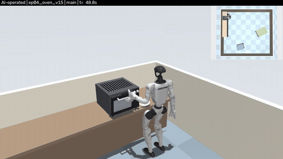</a><br>main view</td><td align="center"><a href="https://drive.google.com/file/d/1R_2messoOGo8LpA9RObU8pUoJrT3hS0O/view">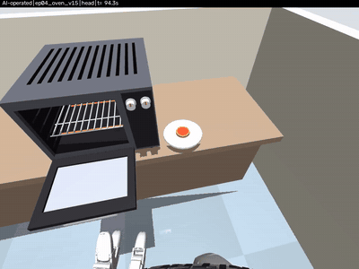</a><br>head view</td><td align="center"><a href="https://drive.google.com/file/d/12-b6JY8Ury-QIvztm9J9mM30ZANdfymc/view">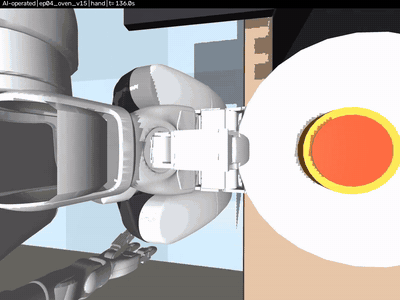</a><br>hand view</td></tr>
<tr><td><b>ep05_oven_v02</b><br>oven v02<br>room 4.72 x 4.65 m<br>8:33</td><td align="center"><a href="https://drive.google.com/file/d/1ldoMKLetltBkxNJ6EJz1dWKEubs2OWC9/view">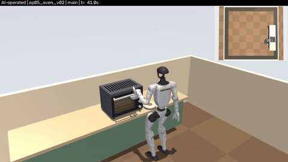</a><br>main view</td><td align="center"><a href="https://drive.google.com/file/d/1i98B4iPF37VjDU_aNItPFY6bZKv0qAPb/view">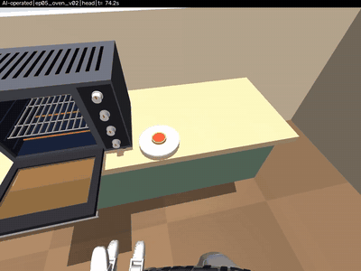</a><br>head view</td><td align="center"><a href="https://drive.google.com/file/d/1ZZDa23Tt0-iVV53bMxvfTheaFMD5EdnH/view">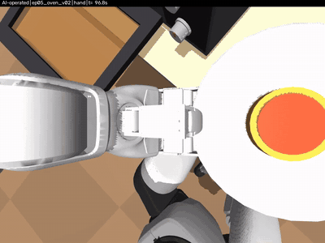</a><br>hand view</td></tr>
</table>

| Episode | Oven | Room | Plate | Walk (pelvis path) | Sim time | Validator | Videos (Google Drive) |
|---|---|---|---|---|---|---|---|
| [ep01_oven_v01](ep01_oven_v01/) | v01 (45 x 33 x 40 cm, 4 knobs) | 5.6 x 5.0 m | 18.0 cm, 300 g | 20.2 m | 7:29 | 20/20 | [main](https://drive.google.com/file/d/1b-FuRY1DEDgqhK9FYFteDDjqZCG2atmF/view) / [head](https://drive.google.com/file/d/1lGMOt_gMoCrD5JfYHwt31m-3fk2zvC6r/view) / [hand](https://drive.google.com/file/d/1GYz-fbLOHWokBU_5nzx4kJMYn58wnn-V/view) |
| [ep02_oven_v13](ep02_oven_v13/) | v13 (54 x 33 x 42 cm, 5 knobs) | 4.26 x 5.35 m | 18.6 cm, 322 g | 18.8 m | 7:51 | 20/20 | [main](https://drive.google.com/file/d/1giA4MM6OwIxPqlcoE12mJhu-exm-LBLy/view) / [head](https://drive.google.com/file/d/1biX2H2bv4C1_oe4UzZ06n7DEf05IT85V/view) / [hand](https://drive.google.com/file/d/1ax3EBs_EoB0cvAJ87ROG2NBk7kBTR5rp/view) |
| [ep03_oven_v06](ep03_oven_v06/) | v06 (56 x 30 x 35 cm, 4 knobs) | 5.45 x 4.65 m | 17.4 cm, 280 g | 23.4 m | 8:33 | 20/20 | [main](https://drive.google.com/file/d/1Y1A11CWfmuH25OKav76GqcmtEpAiP7ef/view) / [head](https://drive.google.com/file/d/1AHWR0iHzwGjfoClS7cum8ZiYz7JVd4ig/view) / [hand](https://drive.google.com/file/d/1dUpJoU6N2EhYZy4WJCeBYQ2FgqCBMNcU/view) |
| [ep04_oven_v15](ep04_oven_v15/) | v15 (45 x 33 x 45 cm, 2 knobs) | 6.21 x 5.6 m | 18.6 cm, 320 g | 24.8 m | 9:08 | 20/20 | [main](https://drive.google.com/file/d/19JxT7KZRxYdH_OkaHmSQxYP0eKEcAykO/view) / [head](https://drive.google.com/file/d/1R_2messoOGo8LpA9RObU8pUoJrT3hS0O/view) / [hand](https://drive.google.com/file/d/12-b6JY8Ury-QIvztm9J9mM30ZANdfymc/view) |
| [ep05_oven_v02](ep05_oven_v02/) | v02 (49 x 37 x 34 cm, 4 knobs) | 4.72 x 4.65 m | 19.6 cm, 356 g | 21.3 m | 8:33 | 20/20 | [main](https://drive.google.com/file/d/1ldoMKLetltBkxNJ6EJz1dWKEubs2OWC9/view) / [head](https://drive.google.com/file/d/1i98B4iPF37VjDU_aNItPFY6bZKv0qAPb/view) / [hand](https://drive.google.com/file/d/1ZZDa23Tt0-iVV53bMxvfTheaFMD5EdnH/view) |

Drive folder with all 15 videos: https://drive.google.com/drive/folders/1ra_jXOphW1DTD0HN_mQZ7omfWcCiGx8J

Videos are H.264 MP4 at 30 fps: main 1280x720, head and hand 960x720. Every frame is labelled "AI-operated". The preview GIFs show 7 seconds of each view; the full videos are on Google Drive because of the GitHub file size limit.

- main: third-person camera that follows the robot and the oven, with the room seen from above in the top-right corner
- head: camera on the torso at the G1 head-camera position, tilted about 48 degrees down, looking at the hands and the work area
- hand: camera on the left wrist (the hand that grips the plate and the door bar), looking at the fingers

## The 11 task steps

| # | Step | What happens |
|---|---|---|
| 1 | `walk_to_counter` | Walk from the start point to the counter and stop in front of the oven |
| 2 | `open_door` | Open the drop-down oven door by hooking the bar and pulling it down to more than 80 degrees |
| 3 | `pick_plate` | Pick up the plate with the food from the counter |
| 4 | `place_on_rack` | Reach into the oven and set the plate on the rack |
| 5 | `close_door` | Close the door |
| 6 | `knob_on` | Turn the oven knob on |
| 7 | `wait_heat` | Wait while the food heats |
| 8 | `open_door_2` | Open the door again |
| 9 | `take_out` | Take the plate out of the oven |
| 10 | `place_on_counter` | Put the plate back on its spot on the counter |
| 11 | `close_door_2` | Close the door again |

Step start and end times for every episode are in `result.json` (`stages`).

## What is recorded

| File in each episode folder | Content |
|---|---|
| `recording.npz` | key `trace` (N x columns, float32), 10 rows per second of simulated time, and key `columns` (names) |
| `scene.json` | Full scene description: room, counter, oven (geometry, door, knobs), plate, food, physics settings |
| `result.json` | The 20 validator checks with values and limits, step times, measurements, controller timing |
| `stages_sheet.jpg` | One frame at the end of each step |
| `previews/` | 7 second GIFs of the three views |

Columns of `trace`: `t` (1), `robot_qpos` (50: pelvis position x y z, quaternion w x y z, then 43 joint angles), `plate_qpos` (7: position and quaternion), `food_pos` (3), `door_deg` (1), `knobs_deg` (4 or 5, depending on the oven), `oven_pos` (3), `oven_yaw` (1). World frame, metres, radians for joints, degrees for the door and knobs.

```python
import numpy as np, json
z = np.load("ep02_oven_v13/recording.npz")
trace = z["trace"]                   # (4716, 71)
print(z["columns"])
res = json.load(open("ep02_oven_v13/result.json"))["result"]
print(res["passed"], [(c["name"], c["value"]) for c in res["checks"]][:3])
```

`render_views.py` shows how the videos were made: it builds the same MuJoCo scene from `scene.json`, sets every recorded value, interpolates the 10 Hz rows to 30 fps and renders offscreen. It needs the scene builder of the controller project (`urc`), which is not part of this repository.

## How the episodes were made

- Controller: a whole-body torque QP for the 43-joint G1 with hand pose and force commands, walking and gripper commands. It runs in MuJoCo with a 2 ms physics step and motor torque limits.
- ep01 (oven v01) was the first full episode, built live step by step with the controller.
- ep02 to ep05 were produced by a goal list and a rule solver: each of the 11 steps is a goal, and the solver plans hand paths and walking legs from the scene description and runs the controller. No learned policy is used.
- Grasping is contact only. Nothing is attached to the hand: the plate rests between the fingers by friction and the door is pulled by its bar.
- Heating is a simple model: the food temperature rises while the knob is on.
- The recordings come from the physics run itself, not from a replay of commands. The videos are rendered from the recorded states.

## The validator

The 20 checks, each with its measured value in `result.json`:

1. all 11 steps done
2. door open for loading (more than 80 degrees)
3. door shut for heating (less than 2 degrees)
4. door open for unloading (more than 80 degrees)
5. door shut at the end (less than 2 degrees)
6. plate on the rack: place error (less than 2 cm)
7. plate on the rack: resting on it (height error less than 5 mm)
8. plate on the rack: tilt (less than 5 degrees)
9. knob turned on (at least 42 degrees)
10. food heated (peak above 40 C)
11. food on the plate at the end
12. plate back on the counter: distance from its spot
13. plate back on the counter: resting on it
14. plate back on the counter: tilt
15. oven drift
16. oven turn
17. other knobs untouched
18. no fall (lowest pelvis height)
19. no wall or furniture contact
20. no body contact with the counter (the hand is excepted)

## Honest notes

- Simulation only: MuJoCo physics, rendered in MuJoCo. Nothing here is real-robot data.
- The door has no latch, so while the oven is heating the robot keeps it shut with its hand.
- Heating is a model, not a thermal simulation of an oven.
- The recording stores the food position but not its orientation; the videos draw it upright.
- Success rate context: these five are passing episodes. In the same generator the rule solver passed only a few percent of 100 varied test scenes. Those failed episodes are not included here, so do not read these five as an average result.
- Every episode is AI-operated.
