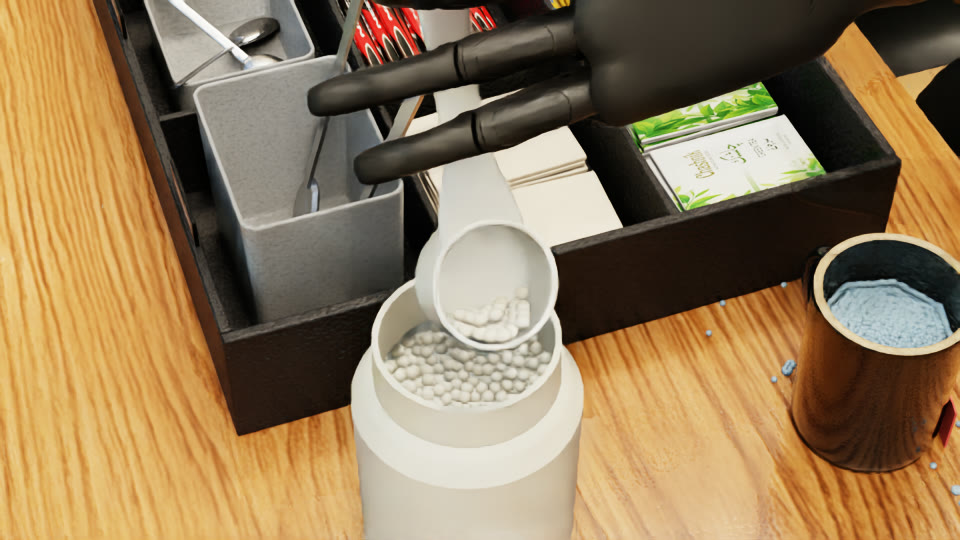
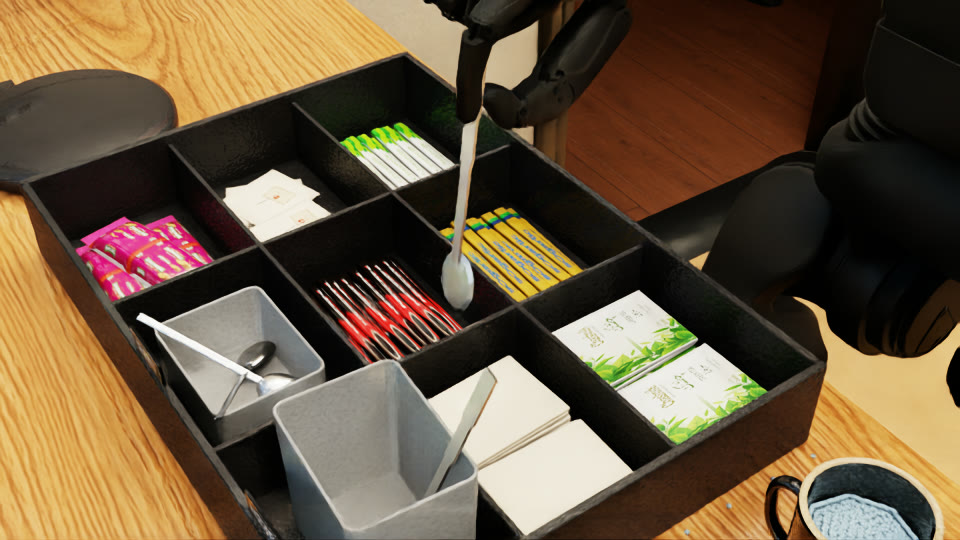
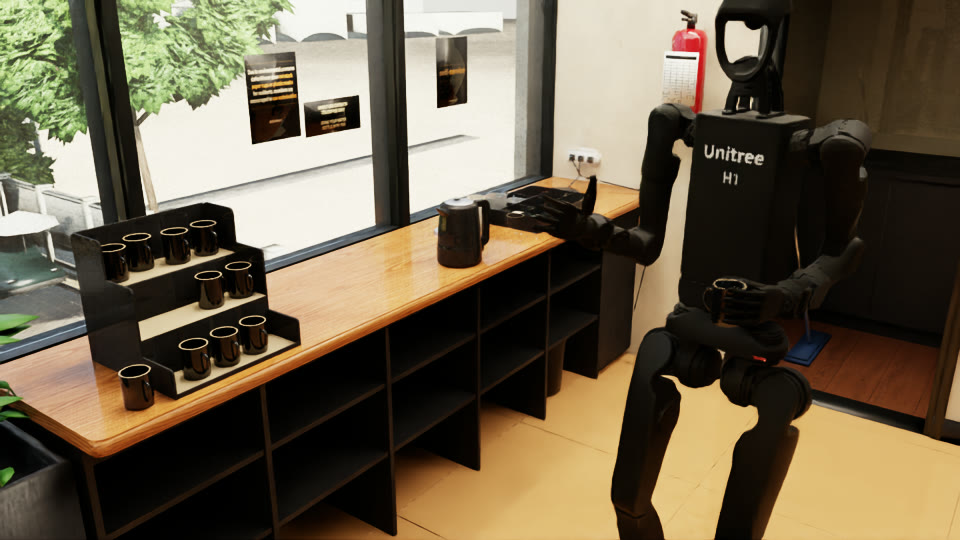

# Unitree H1-2 tea episode in Isaac Sim (PhysX)

One simulated episode, joined from five saved runs, in which a Unitree H1-2 humanoid with five-finger hands is scripted to walk into a tea corner and make a cup of tea, with live
particle water and contact-only grasps. This repo holds the code, the data format and the plain list of what was added or assumed, so that
robotics engineers can judge whether the data point is sound.

**Results come from the saved runs listed in [data/README.md](data/README.md). Watch the full episode: [h12_tea_full_episode.mp4](https://drive.google.com/file/d/1s6GQjwAkeg5sQVbLCLtaNnbzqOu75sJI/view).**
Read [DISCLOSURES.md](DISCLOSURES.md) before you read any number here.

## The episode

| # | Step | What the robot does | Task check in code |
|---|---|---|---|
| 1 | Walk in | Walks from the entrance to the mug rack on Unitree's pretrained walking policy | Stance reached, no fall |
| 2 | Mug from rack | Crouches, left hand wraps a mug on the rack, lifts, carries it about 1.4 m, sets it on the counter | On the counter within 25 mm of the spot, tilt under 5 deg. The strict step status needs 5 mm |
| 3 | Tea bag | Right thumb-index pinch takes the bag from the tray and puts it in the mug | Bag inside the mug, mug moved under the hold limit, tilt under 5 deg |
| 4 | Kettle pour | Right hand lifts the kettle (700 ml of live water), pours, walks it aside, sets it down, releases | At least 100 ml in the mug, at most 3 ml spilled, kettle upright, released, on a surface, mug and jar moved under 5 mm |
| 5 | Milk powder | Left hand takes the jar lid off, then scoops rigid grains from the jar and tips them into the mug | Lid on the counter and at least 20 grains in the mug (working target) |
| 6 | Stir | Spoon from the tub, at least two turns with the bowl inside the mug below the rim, spoon back on the counter | Spoon lifted at least 50 mm, two or more full-radius turns, bowl below the rim and inside the cavity, spoon on the counter |
| 7 | Carry away | Picks up the prepared mug and walks to the exit with it | Held, standing, upright, within 0.2 m of the exit, 3 ml or less lost |

Motion comes from scripted stages that use inverse kinematics, joint position targets, finger creep-to-contact and walking commands. It is not a
learned policy, apart from the leg policy used to walk. The stages read ground-truth poses and contact forces from the simulator. There is no camera or perception in the loop.

## Simulator and physics settings

These were read from the code and from the start of the final run's log, not from memory.

| Setting | Value | Where |
|---|---|---|
| Simulator | Isaac Sim 6.2.0-rc.14 (a release candidate build), standalone Python, headless | `<isaac-sim>/VERSION` |
| Physics | PhysX with GPU dynamics and GPU broadphase | `code/fluids/boot.py` `set_scene` |
| Solver | TGS | same |
| Rate | 600 Hz, `DT = 1/600`, one step per tick. Walking policy and arm servo run every 12 steps, 50 Hz | `code/h12_physx.py` |
| Solver iterations | 32 position, 1 velocity on the robot articulation. **8 position, 1 velocity on the 341 other rigid bodies.** 4 on the water | `boot.set_iters`, log line `solver iterations: articulation 32 bodies 8 on 341` |
| Finger linkage | `mimic=True`: PhysX mimic joints from the URDF, 12 joints, one motor per finger | `h12_physx.Sim`, log line `mimic joints 12` |
| Joint limits | Drive force capped at the URDF effort limits | `h12_physx.Sim` |
| Hand contact | Friction 1.0 on 26 hand links. **Assumption**, see DISCLOSURES.md | `PAD=1`, log line `pad friction 1.0 bound on links 26` |
| Water | Live PBD particles, 80179 particles = 700 ml, particle radius 1.25 mm, density 1000 kg/m3, viscosity 1.7e-6, surface tension 0.0074, cohesion 0.1, friction 0.02 | `code/fluids/fluids.py` |
| Powder | 300 rigid spheres, not a powder model. See DISCLOSURES.md | `code/steps/powder/` |
| Convex hulls | Hull vertex limit 32 on 34 scene colliders, so that particles collide with them on the GPU | `Fluids.gpu_safe_hulls` |

Nothing is welded, attached or teleported after spawn, and no external force is applied to any object. A search of the released code finds state writes only
in the initial spawn (`h12_physx.py`), and the only joint between free objects is the tea bag's string (DISCLOSURES.md). The robot's own hand gains do change during stages, which is also listed there.

## How to reproduce

You cannot run this from the repo alone yet: **the tea-corner scene is not included** until its licence is settled (THIRD_PARTY.md). **The path-rewritten copy in `code/` has also not been run under Isaac Sim yet**: it has only been compiled and its imports resolved. With the scene you need:

- Windows, an NVIDIA RTX GPU (runs here used an RTX 3090, 24 GB), 9 to 13 GB of free commit memory per simulator process
- Isaac Sim 6.2 (not redistributed here; accept NVIDIA's licence yourself)
- `onnxruntime` in Isaac Sim's Python, or in a folder named by `H12_PYLIB`
- A long wait: a GPU run with live water takes many hours

```powershell
.\reproduce\run_final.ps1 -IsaacPython <isaac-sim>\python.bat -SceneDir <folder with environment.usda and corrections.json> -Tag repro01
```

That script sets the same environment as the final run: `MODE=gpu`, `EP_ITERS=32`, `PAD=1`, `FILL_ML=700`, `KEEP_GOING=1`, `SQ=0.5`, `LOW=1.0`, `TSQ=0.5`, `LEVEL=0`,
`STEPS=teabag,kettle,powder,stir` (those from `code/run_live_episode.py`) and `P_SCOOP=real`. Outputs go to `out/logs/`.

Do not expect the same numbers: identical recipes have differed from run to run on this GPU setup, and the code makes no attempt at bit-exact replay.
Rendering afterwards: `<isaac-sim>\python.bat code\props\record.py <rec.npz> <name> --no-looks` with `P_SCOOP=real` set, or the old scoop shape is drawn.

Quick checks that need no simulator:

```
python examples/load_rec.py --self-test
python tools/scan_release.py --self-test
```

## What is in the repo

| Path | Contents |
|---|---|
| `DISCLOSURES.md` | Everything added, modelled or changed, and the gates that fail |
| `THIRD_PARTY.md` | Every third-party asset, its licence, and what was left out and why |
| `docs/DATA_FORMAT.md` | Recording and particle file format |
| `docs/DATA_HOSTING.md` | File sizes and where the large data goes |
| `code/` | Only what the final run imports. `code/SOURCE_MANIFEST.json` lists source and release hashes |
| `assets/` | H1-2 URDF and USD, Unitree walking policy, with their BSD-3-Clause licence |
| `examples/load_rec.py` | Loader for the recording and the particle file, numpy only |
| `tools/` | `collect_run.py` (drops a run in), `export_code.py`, `scan_release.py`, `sanitize.py` |
| `reproduce/run_final.ps1` | The launch command |
| `data/<run>/` | Saved runs: logs, reports where the run wrote them, recordings. See [data/README.md](data/README.md) |
| `videos/` | Video index with links |

The hundreds of per-stage experiments, debug tools and test launchers are not included. The code is the same as the working tree except for machine paths, a small import block and two comments; `tools/export_code.py` states the exact changes. **Until a run is collected, `code/` is a snapshot taken during the final run, and a stage not yet started in that run may still change** (DISCLOSURES.md section 5). `collect_run.py --refresh-code` updates it.

## Data files

The saved runs and their links are in [data/README.md](data/README.md). A collected final run, under `runs/<tag>/`, holds a 30 Hz pose recording (`<tag>_rec.npz`), a joint-position file (`<tag>.npz`), the gate report (`<tag>_gates.json`), the step report (`<tag>.json`) and the log. The water particle
file is several GB and is hosted apart, with its hash in `particles.ref.json`. Formats are in [docs/DATA_FORMAT.md](docs/DATA_FORMAT.md).

## Real result versus assumption

| Item | Standing |
|---|---|
| Rigid-body motion of robot, objects and grains | Simulated by PhysX from contact and joint drives |
| Water volumes in the mug and kettle | Counted from live particle positions against the measured mug and kettle pose. A geometric count, with no independent check |
| Torque, slip, penetration, fall, movement, spill numbers | Measured every physics step inside the simulator (spill every 60 steps). They are simulator readings, not hardware measurements |
| Robot mass, inertia, joint limits, effort limits | From Unitree's URDF, not re-identified |
| Walking | Unitree's pretrained policy, unchanged weights. Not validated against hardware |
| Hand friction 1.0 | **Assumption**, not measured |
| Object masses and friction (spoon, bag, scoop, lid, powder) | **Assumption** or chosen values |
| Scoop, lid knob, grains, tea bag and its string joint | **Added or modelled**, not from the real scene |
| Scene geometry | A digital twin built from photos and video of a real room, corrected by hand. Not a survey |
| Real-robot transfer | **Not tested at all.** No claim is made. Robot self-collision is off |
| Tea chemistry, heat, dissolving | **Not simulated.** Water is room-temperature particles, grains never dissolve, the bag does not steep |

## Results

<!-- RESULTS:BEGIN -->
Results so far are from the saved runs in [data/README.md](data/README.md). Final results will be added.
<!-- RESULTS:END -->

## Earlier isolated tests: NOT the final run

These are test setups, each started part way through the episode or stopped early. They are here to show what has and has not been seen working. **None of them is a result of the final run, and a pass here does not carry over to it.**

| Step | Test | Setup | Outcome | Numbers |
|---|---|---|---|---|
| Mug grasp | `gpu_grip01` | GPU with live water in the scene, starts at the rack, grasp and lift only, older controller revision | All six strict gates PASS | 61.0 mm lift, slip 3.989 mm, torque ratio 0.47, penetration 0.123 mm |
| Kettle pour | `kl07` | GPU, 700 ml, pour stage `k16`, driven under a debug wrapper that froze at the top of the pour and after tilt-back | Pour reached its target. Run ended before set-down; no gate report exists | 101.3 ml in mug, 0.4 ml spill at t 74.0 s, peak tilt 69.3 deg |
| Carry away | `cup_gpu03` | GPU, cup test started at the counter with 113 ml authored in the mug | Task PASS, strict FAIL | 109.8 ml at the end, 0.3 ml lost in carry, 0.081 m from exit; slip 13.2 mm, torque ratio 2.83, spill 3.2 ml |
| Stir | `s_gpu05` | GPU, 32 iterations, stage `s2`, 85 ml authored in the mug | **FAIL** | Hand 253.5 mm and 78.3 deg off at the spoon |
| Milk powder | `p2_gr3` | GPU, stage `p2x`, new scoop, spill not measured | **FAIL** | Lid off and on the counter, then tool lost at step `d1_out`, 50 mm off |

No run has yet completed the whole episode. Six earlier attempts (`final01` to `final06`) were stopped or lost before their end, and none of them wrote a final report.

## Licence

Not chosen yet: see [LICENSE](LICENSE). The third-party files keep their own licences (THIRD_PARTY.md).


---

<table>
<tr>
<td align="center"><br><b>Powder, run f13</b></td>
<td align="center"><br><b>Spoon out of the tub, run f17</b></td>
<td align="center"><br><b>Cup carry, run f16</b></td>
</tr>
</table>
