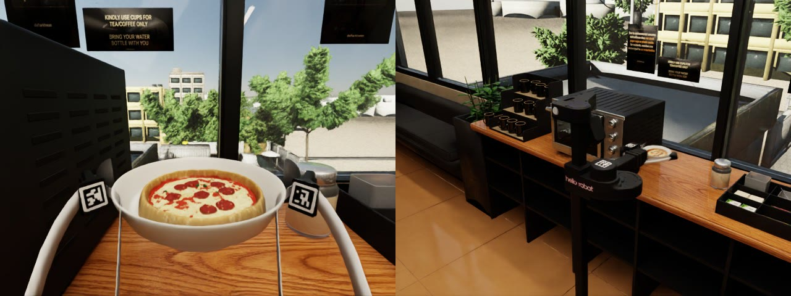
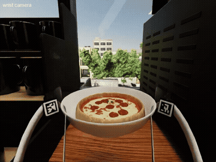
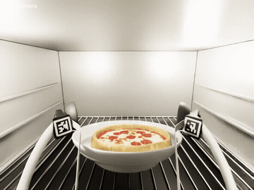
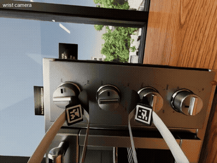
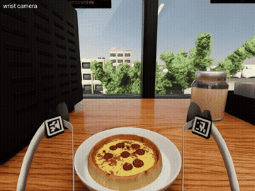
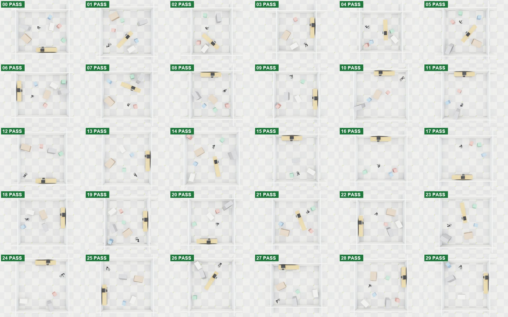

<div align="center">

# Stretch pizza

A Stretch 3 puts a pizza in an oven and takes it out, in one continuous take

<a href="https://drive.google.com/file/d/1TLCOr916MN6OHsVB2__FtIA-nRvagDT1/view"></a>

</div>

A Stretch 3 takes a plate with a pizza, carries it past the oven and sets it down, opens the oven door, places the plate on the rack and closes the door. It turns three knobs, waits, opens the door, takes the plate out and carries it back.

| | |
|---|---|
| Robot | Hello Robot Stretch 3 |
| Simulator | Isaac Sim, CPU PhysX |
| Operation | AI-operated |
| Episode | One continuous take, 20:49 of sim time, 37,472 samples |
| Recording | 30 samples per sim second |
| Camera views | Head, wrist and fixed |

<a href="https://drive.google.com/file/d/1bP5InmzR3Xd1kR4S9nY7Jc7U2xoaq0LF/view"></a> <a href="https://drive.google.com/file/d/1bP5InmzR3Xd1kR4S9nY7Jc7U2xoaq0LF/view"></a> <a href="https://drive.google.com/file/d/1bP5InmzR3Xd1kR4S9nY7Jc7U2xoaq0LF/view"></a> <a href="https://drive.google.com/file/d/1bP5InmzR3Xd1kR4S9nY7Jc7U2xoaq0LF/view"></a>

[All Stretch videos](videos/README.md)

### Also: the same skill in 30 generated rooms

<a href="rooms/README.md"></a>

30 rooms generated in code, each with its own size, counter position and angle, furniture, oven and plate placement and robot start. The Stretch drives a planned route to the counter and puts the plate on the rack: 30 of 30 pass, recorded in full. Isaac Lab, GPU PhysX. [Details, data and videos](rooms/README.md).

---

## Data

### `data/`

NumPy `.npz`, one sample every 1/30 of a sim second.

| Key | Shape | Meaning |
|---|---|---|
| `t` | N | Sim time, seconds |
| `names` | 20 | Joint names |
| `links` | 37 | Link names |
| `q`, `dq` | N x 20 | Joint positions and velocities |
| `qd`, `vd` | N x 20 | Commanded position and velocity targets |
| `root` | N x 7 | Base pose: x y z, quaternion x y z w |
| `link` | N x 37 x 7 | Pose of every link |
| `oven` | N x 5 | Oven joints, door first, radians |
| `plate`, `pizza` | N x 7 | Object poses |
| `body` | N x 7 | Oven body pose |
| `heat` | N x 2 | Pizza colour-change amount and oven-on flag |
| `video_frame` | N | Index of the rendered film frame at each sample |

`data/pz_final06_views_index.csv` maps each video frame to its sample and sim time. The videos run at 10 fps and show every third sample at real speed.

`lerobot/` holds the same take as a LeRobot v3.0 dataset at 10 fps: state, velocity, base pose, oven joints, plate and pizza poses, and commanded targets as the action. The head, wrist and fixed camera videos are 630 MB, so the complete dataset, with videos, is on Drive: [LeRobot dataset](https://drive.google.com/drive/folders/1GRNoe8o7cBJNFRZHqCCtMN1NETl9DcR1). Copy its `videos/` folder into `lerobot/` to use the cameras.

---

## Load the data

Run these from this folder.

```bash
python examples/load_stretch.py data/pz_final06_rec.npz
python examples/load_lerobot.py lerobot
```

```python
import numpy as np

d = dict(np.load("data/pz_final06_rec.npz"))
print(d["t"].shape, d["q"].shape, d["plate"][-1])
```

---

## Layout

```
videos/    video index and previews
data/      full recording
lerobot/   LeRobot v3.0 dataset
code/      task, oven, kitchen, recorder, replay and export code
audit/     collision audit of this take
examples/  data loaders
```
