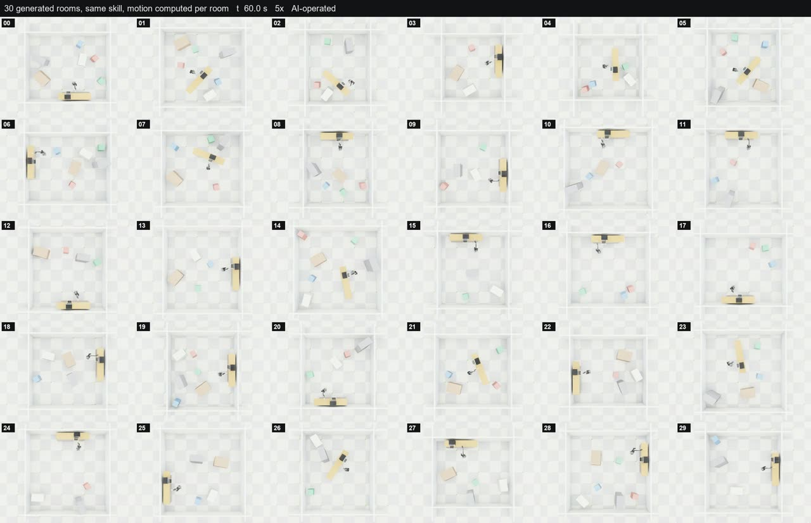
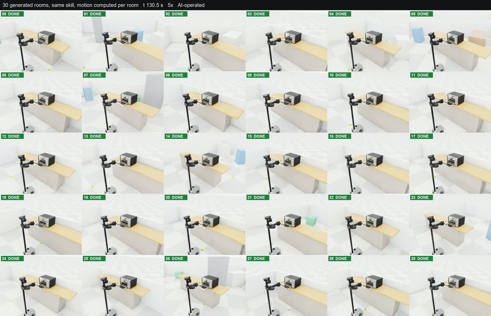
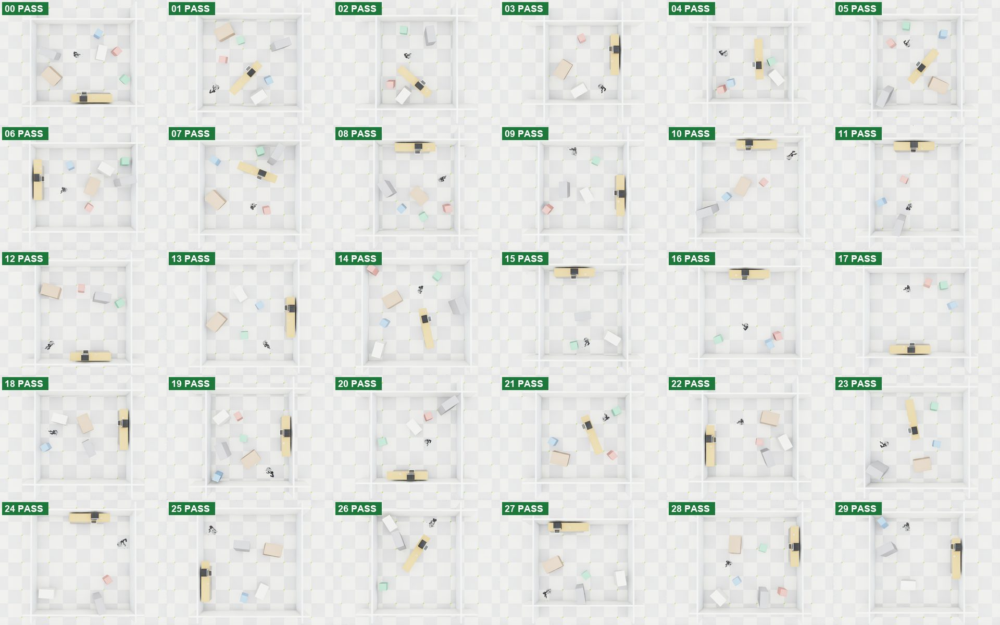

<div align="center">

# Stretch in 30 rooms

The same skill in 30 generated rooms, each one different

<a href="https://drive.google.com/file/d/19aO6WEWB7EynZ1hfPsFnlp0z9hlEFTBO/view"></a>

</div>

A Stretch 3 starts somewhere in a room it has never seen, drives a planned route around the furniture to the counter, picks the plate with the pizza off the counter and sets it on the oven rack. Every room is generated in code: its size, where the counter stands and at what angle, where the oven and the plate sit on the counter, the furniture, and where the robot starts and which way it faces. The robot's motion is computed from each room's measured geometry; nothing is replayed.

| | |
|---|---|
| Robot | Hello Robot Stretch 3 |
| Simulator | Isaac Lab, GPU PhysX, 30 rooms side by side |
| Operation | AI-operated |
| Result | 30 of 30 pass |
| Episode length | 98.7 to 130.6 s of sim time |
| Recording | 10 samples per sim second |
| Wall time | 32.7 min for all 30, video frames included |
| Oven door | open at the start; the task is drive, pick, place on the rack |
| Oven, plate, counter | the same models in every room |

<a href="https://drive.google.com/file/d/1kP2s6cugAn1OJmbi4qGc3krJoqp55e97/view"></a>

[All 32 videos on Drive](https://drive.google.com/drive/folders/1VcgLJuczYO9jHj3HqcdHHKjxjDzMqdFa): one per room (room from above and close on the oven, side by side, 5x speed) and two grids of all 30 rooms.

---

## What changes from room to room

| | Range over the 30 rooms |
|---|---|
| Room size | 5.0 to 7.1 m a side |
| Counter | anywhere in the room, 13 different angles; 21 against a wall, 9 free-standing |
| Oven along the counter | 0.79 to 2.29 m from the counter's end |
| Plate | either side of the oven, 14 to 60 cm from it |
| Furniture | 3 to 6 pieces (table, island, two chairs, cabinet, crate), each placed and turned at random |
| Robot start | any free spot, any heading |
| Route to the counter | 1.35 to 7.12 m, planned on a 5 cm floor grid around the furniture |

Room layouts at the start:



---

## Checks on every episode

Plate within 20 mm of the rack spot and 8 mm in height, tilt under 5 deg, pizza still on the plate, oven moved under 5 mm and 0.5 deg, hand out of the oven by at least 150 mm. Walls and furniture are solid and cannot be pushed. Plate error over the 30: 1.8 to 8.5 mm.

| Room | Size (m) | Counter angle | Counter | Furniture | Route (m) | Oven x | Plate x | Plate error (mm) | Done at (s) | Result |
|---|---|---|---|---|---|---|---|---|---|---|
| [00](https://drive.google.com/file/d/13-V0asgIcaWP7EFK12MUFAJUouq7sTRt/view) | 6.8 x 5.6 | 180 | wall | 6 | 2.43 | 2.08 | 1.41 | 3.9 | 110.1 | pass |
| [01](https://drive.google.com/file/d/1NtsYa1ih4fpctngQaa66LHNbwmZIKojp/view) | 6.9 x 6.3 | 227 | free | 6 | 2.00 | 0.99 | 1.71 | 5.1 | 105.8 | pass |
| [02](https://drive.google.com/file/d/17k_JV-Nm44JZNkCXIaChGHLGkqA-A4QE/view) | 5.2 x 6.0 | 138 | free | 4 | 2.87 | 1.11 | 0.51 | 2.9 | 109.2 | pass |
| [03](https://drive.google.com/file/d/1Ydeb-Lr-dJcs9TcQbOKcpLfamn-Bzmza/view) | 5.0 x 5.4 | 270 | wall | 3 | 2.05 | 1.21 | 1.97 | 8.5 | 106.6 | pass |
| [04](https://drive.google.com/file/d/12N4A_o701HBeVdn32RvVU1bNSh3W1-3T/view) | 5.5 x 5.2 | 272 | free | 4 | 1.75 | 1.94 | 1.54 | 3.4 | 104.5 | pass |
| [05](https://drive.google.com/file/d/1xdxVP0ogGwywllKnlBIyEKPwsMDoTsUu/view) | 5.8 x 6.2 | 230 | free | 5 | 1.59 | 1.68 | 2.14 | 3.9 | 108.0 | pass |
| [06](https://drive.google.com/file/d/1xKgb6rOjCLgNyPkfmwZ4fdCnaG1h6XNe/view) | 6.9 x 5.7 | 90 | wall | 6 | 1.90 | 1.64 | 2.26 | 3.8 | 113.6 | pass |
| [07](https://drive.google.com/file/d/1n0Hmmzhc7ene-bBv27LIrOwl-_nW4Z-F/view) | 6.6 x 6.1 | 339 | free | 5 | 1.45 | 1.83 | 1.19 | 2.5 | 100.6 | pass |
| [08](https://drive.google.com/file/d/1TJAHFZAuL2gUSVC4TFGtxrBkQkzuWZd6/view) | 5.5 x 6.2 | 0 | wall | 5 | 1.35 | 1.75 | 2.44 | 5.1 | 101.6 | pass |
| [09](https://drive.google.com/file/d/1Sd68Jd8xrpyItAKqF_etc8lr9G9yTBvs/view) | 5.8 x 6.1 | 270 | wall | 4 | 3.82 | 1.41 | 1.91 | 6.2 | 118.0 | pass |
| [10](https://drive.google.com/file/d/104UIK4N7XsDZZoWGRvwihrNJLIIz_cvu/view) | 7.0 x 6.6 | 0 | wall | 4 | 3.44 | 1.02 | 0.55 | 3.9 | 107.4 | pass |
| [11](https://drive.google.com/file/d/1M7MO87y2UNxe8xcIChmHzP9naM2PX3NQ/view) | 6.1 x 6.4 | 0 | wall | 3 | 3.34 | 1.52 | 2.06 | 3.5 | 113.2 | pass |
| [12](https://drive.google.com/file/d/12f-hJuoT8CAgrf7yGHMa0iMAm1Bpl_iC/view) | 6.2 x 6.7 | 180 | wall | 4 | 3.18 | 1.90 | 1.14 | 2.7 | 108.8 | pass |
| [13](https://drive.google.com/file/d/1_8a_j0n4nGEjLaRbGeiDkrX23Wq434iS/view) | 6.3 x 7.0 | 270 | wall | 4 | 1.78 | 0.95 | 1.76 | 3.1 | 103.4 | pass |
| [14](https://drive.google.com/file/d/1NDi8oNCLVpPjFdu9XFNx8T1B_e1YiiO3/view) | 7.0 x 7.0 | 102 | free | 6 | 1.71 | 2.17 | 2.62 | 4.5 | 98.7 | pass |
| [15](https://drive.google.com/file/d/1-zPMIn5CWGNT9w4NdJOeyNBmqo0Sk_xh/view) | 5.7 x 6.2 | 0 | wall | 3 | 4.56 | 1.54 | 2.28 | 4.8 | 122.7 | pass |
| [16](https://drive.google.com/file/d/1V4canuXfa3-QxD1LWRKlY8vzuGAjuBoC/view) | 6.6 x 6.0 | 0 | wall | 3 | 2.76 | 1.25 | 0.65 | 6.6 | 111.7 | pass |
| [17](https://drive.google.com/file/d/1rxpux5Ar0joj8QcuLRb5PkgQLJgrdxg-/view) | 6.9 x 5.8 | 180 | wall | 3 | 3.15 | 1.43 | 1.92 | 4.0 | 108.7 | pass |
| [18](https://drive.google.com/file/d/17CIavg7c8j3S5hi07wcv0puLNkZoXhQG/view) | 6.2 x 6.1 | 270 | wall | 4 | 7.12 | 1.15 | 0.72 | 3.9 | 130.6 | pass |
| [19](https://drive.google.com/file/d/104JMEQgcanQTO3PFg3ZePp-ahCfZPcvT/view) | 5.7 x 6.4 | 270 | wall | 6 | 2.02 | 1.34 | 2.00 | 3.3 | 106.7 | pass |
| [20](https://drive.google.com/file/d/1gvk9byP_cg8boILC4N9QrhfDO1A6k4m9/view) | 5.8 x 5.9 | 180 | wall | 4 | 2.12 | 1.29 | 2.00 | 7.4 | 113.2 | pass |
| [21](https://drive.google.com/file/d/1sICvUzwL_tpQGgZiKUYg9kobXAvgysSA/view) | 6.1 x 5.9 | 292 | free | 4 | 4.56 | 0.85 | 1.42 | 5.3 | 129.4 | pass |
| [22](https://drive.google.com/file/d/1jHq2W3kYGqUhTPZMduZlMbXt4Zm-iuRA/view) | 6.2 x 5.7 | 90 | wall | 4 | 1.84 | 2.00 | 1.48 | 2.0 | 100.8 | pass |
| [23](https://drive.google.com/file/d/1Hg8HW9JLT5KlbRA9a6ynjqzNUxz0d-VE/view) | 6.8 x 6.6 | 280 | free | 4 | 1.93 | 2.29 | 1.73 | 1.9 | 104.5 | pass |
| [24](https://drive.google.com/file/d/14EyEKgkuIFGdh62SZAuXypRDAKhz4bfR/view) | 6.8 x 6.8 | 0 | wall | 3 | 1.50 | 1.85 | 2.29 | 5.0 | 102.7 | pass |
| [25](https://drive.google.com/file/d/16b8TKhM4B2bV36wIT_UfLyYyQBhN0hE3/view) | 6.8 x 7.0 | 90 | wall | 4 | 3.54 | 2.15 | 1.37 | 1.8 | 110.7 | pass |
| [26](https://drive.google.com/file/d/1k8P6Qp9prhLm_mknlVzTGjDycFLvgZK7/view) | 5.7 x 6.8 | 57 | free | 3 | 2.94 | 2.24 | 1.42 | 2.3 | 107.9 | pass |
| [27](https://drive.google.com/file/d/1EYBsj5WN0SMUyfyVV4dFYDB07WhrVbjp/view) | 6.5 x 5.6 | 0 | wall | 4 | 4.44 | 0.83 | 1.63 | 8.4 | 125.8 | pass |
| [28](https://drive.google.com/file/d/1SlnjAUC36Tx0wTJQ4-8sKpMa3vnljTHg/view) | 6.8 x 6.6 | 270 | wall | 6 | 4.53 | 1.58 | 0.74 | 4.5 | 121.2 | pass |
| [29](https://drive.google.com/file/d/15X1ai5HkGMtI9822hlPuUcYTDrWHMNG4/view) | 6.1 x 6.5 | 270 | wall | 3 | 3.11 | 0.79 | 1.38 | 4.4 | 112.9 | pass |

The room number links to that room's video.

---

## Data

### `data/`

One NumPy `.npz` per room, `e0000.npz` to `e0029.npz`, plus `index.json` (every room's layout, result and checks) and `results.json`. Positions are in metres from the room's centre.

| Key | Shape | Meaning |
|---|---|---|
| `t` | N | Sim time, seconds |
| `names`, `links`, `oven_names` | 20, 37, 5 | Joint, link and oven joint names |
| `q`, `dq` | N x 20 | Joint positions and velocities |
| `qd`, `vd` | N x 20 | Commanded position and velocity targets |
| `root` | N x 7 | Base pose: x y z, quaternion x y z w |
| `link` | N x 37 x 7 | Pose of every link |
| `oven` | N x 5 | Oven joints, door first, radians |
| `plate`, `pizza`, `body` | N x 7 | Plate, pizza and oven body poses |
| `ok`, `fails`, `params` | | Result, failed checks, and the room, counter and check values as JSON |
| `room_size`, `counter_xy`, `counter_angle`, `furniture`, `start`, `route` | | The room layout |

```python
import numpy as np, json

d = dict(np.load("data/e0007.npz", allow_pickle=True))
print(d["t"].shape, d["q"].shape, bool(d["ok"]))
print(json.loads(str(d["params"]))["room"])
```

---

## Layout

```
data/      30 episodes, index and results
previews/  images used on this page
code/      room generator, skill and launcher (Isaac Lab), video builder
```

`code/pz_rooms.py` is generated by `code/build_pz_rooms.py` from `code/rooms_body.txt`; `code/test_room_gen.py` draws the generated rooms without a simulator. The scripts keep this PC's asset and output paths.
